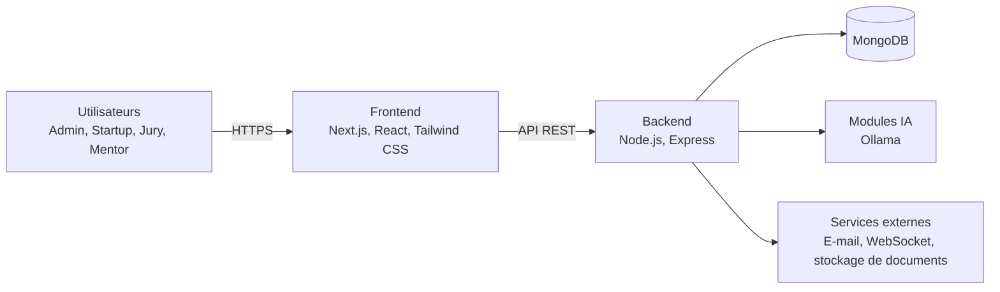

# MEDIANET Incubator

Plateforme web de gestion du processus d'incubation de MEDIANET Incubateur : candidatures, évaluation par des jurys, suivi des startups incubées, mise en relation avec mentors et investisseurs, avec des modules d'intelligence artificielle (scoring, matching, reporting, chatbot).

Projet de fin d'études (PFE) de la Licence en Génie Logiciel et Systèmes d'Information, ISI, Université Tunis El Manar. Réalisé au sein de MEDIANET.


<!-- À COMPLÉTER : ajouter 2 à 4 captures dans docs/screenshots/ (tableau de bord admin, formulaire de candidature, évaluation jury, matching) -->

## Contexte

La gestion d'un programme d'incubation implique plusieurs acteurs (administrateurs, startups, jurys, mentors, investisseurs). Avant ce projet, les candidatures reposaient sur des formulaires en ligne, des fichiers partagés et des échanges par e-mail, avec des évaluations partiellement manuelles, peu de traçabilité et aucun outil d'aide à la décision.

L'objectif est de centraliser tout le cycle d'incubation dans une seule plateforme, depuis le dépôt de la candidature jusqu'à l'accompagnement de la startup.

## Fonctionnalités

| Acteur | Fonctionnalités principales |
|---|---|
| Administrateur | Gestion des rôles et comptes internes, programmes d'incubation, formulaires de candidature configurables, assignation des jurys, décision finale, gestion des startups incubées, sessions d'accompagnement, suivi des KPIs |
| Startup | Inscription avec confirmation par e-mail, consultation des programmes, candidature (y compris spontanée) avec dépôt de documents, suivi de l'avancement ; une fois acceptée : profil, KPIs, documents partagés, sessions |
| Jury | Consultation des candidatures assignées, évaluation selon une grille, notes et remarques |
| Mentor | Suivi des startups affectées, planification des sessions, feedbacks, rapports mensuels |

### Modules d'intelligence artificielle

Les modules s'appuient sur Ollama (LLM exécuté en local). Leurs résultats sont des aides à la décision, validées par les utilisateurs concernés.

- **Scoring des candidatures** : analyse des dossiers, score et synthèse pour assister l'évaluation.
- **Matching** : recommandation des mentors et des investisseurs les plus compatibles avec les besoins d'une startup.
- **Reporting** : synthèse des évaluations des jurys pour préparer la décision finale.
- **Chatbot** : assistance aux visiteurs depuis l'espace public, avec redirection vers le responsable en cas de question non résolue.

## Architecture



L'architecture est organisée en couches (présentation, métier et API, IA, données, services externes) pour séparer les responsabilités et faciliter l'évolution du projet.

## Stack technique

| Couche | Technologies |
|---|---|
| Frontend | React.js, Next.js, Tailwind CSS |
| Backend | Node.js, Express.js (API REST) |
| Base de données | MongoDB |
| IA | Ollama (LLM local) |
| Authentification | JWT, confirmation de compte par e-mail, contrôle d'accès par rôles |
| Outils | Git, Postman, Figma, Enterprise Architect, draw.io |

## Installation

### Prérequis

- Node.js 18 ou supérieur
- MongoDB (local ou Atlas)
- Ollama avec un modèle installé (pour les modules IA)

### Lancement

```bash
git clone https://github.com/tass027/medianet-incubator.git
cd medianet-incubator
```

Backend :

```bash
cd backend
npm install
cp .env.example .env   # renseigner les variables
npm run dev
```

Frontend :

```bash
cd frontend
npm install
npm run dev
```

<!-- À COMPLÉTER : vérifier les noms des scripts (package.json), les ports et créer le fichier .env.example -->

### Variables d'environnement (backend)

| Variable | Rôle |
|---|---|
| `PORT` | Port de l'API |
| `MONGODB_URI` | Connexion à MongoDB |
| `JWT_SECRET` | Clé de signature des tokens |
| `SMTP_*` | Envoi des e-mails (confirmation, invitations, notifications) |
| `OLLAMA_URL` | Adresse du serveur Ollama |
| `FRONTEND_URL` | URL du frontend (liens des e-mails) |

## Structure du dépôt

```
medianet-incubator/
├── backend/    # API REST, logique métier, modules IA
├── frontend/   # Interfaces Next.js
└── docs/       # Captures d'écran et schémas d'architecture
```

## Méthodologie

Développement agile avec Scrum, en trois sprints :

| Sprint | Périmètre |
|---|---|
| 1 | Gestion des accès, comptes internes, programmes, formulaires et dépôt de candidatures |
| 2 | Suivi des candidatures, évaluation par les jurys, scoring et rapport intelligents, décision finale |
| 3 | Espace startup incubée, mentors, matching intelligent, sessions, KPIs, documents, chatbot |

Modélisation UML (cas d'utilisation, classes, séquence, activité) et maquettes Figma réalisées avant l'implémentation.

## Auteure

Tasnim Elmehrabi — [GitHub](https://github.com/tass027) · [LinkedIn](https://www.linkedin.com/in/VOTRE-PROFIL)
