# MEDIANET Incubator

Plateforme web de gestion du processus d'incubation de MEDIANET Incubateur : candidatures, évaluation par des jurys, suivi des startups incubées, mise en relation avec mentors et investisseurs, avec des modules d'intelligence artificielle (scoring, matching, reporting, chatbot).

Projet de fin d'études (PFE) de la Licence en Génie Logiciel et Systèmes d'Information, ISI, Université Tunis El Manar. Réalisé au sein de MEDIANET.

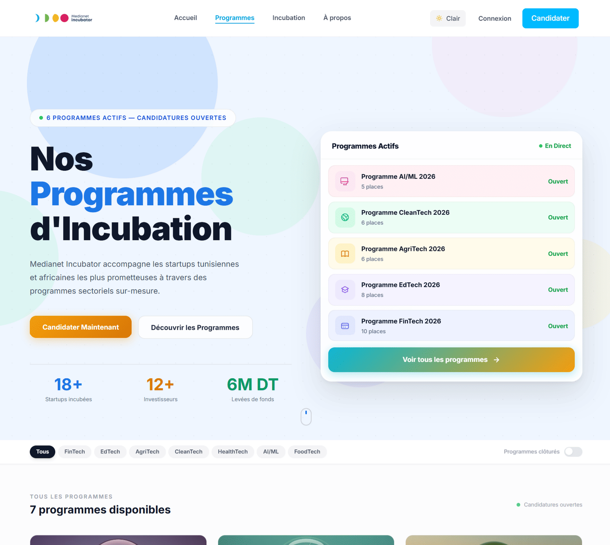

## Contexte

La gestion d'un programme d'incubation implique plusieurs acteurs (administrateurs, startups, jurys, mentors, investisseurs). Avant ce projet, les candidatures reposaient sur des formulaires en ligne, des fichiers partagés et des échanges par e-mail, avec des évaluations partiellement manuelles, peu de traçabilité et aucun outil d'aide à la décision.

L'objectif est de centraliser tout le cycle d'incubation dans une seule plateforme, depuis le dépôt de la candidature jusqu'à l'accompagnement de la startup.

## Fonctionnalités

| Acteur | Fonctionnalités principales |
|---|---|
| Administrateur | Gestion des rôles et permissions, comptes internes créés par invitation e-mail, formulaires de candidature configurables, programmes d'incubation (création, publication, clôture), assignation des jurys, décision finale avec notification par e-mail, gestion des startups incubées et de leurs besoins, assignation des mentors et investisseurs, sessions d'accompagnement, suivi des KPIs |
| Startup | Inscription et connexion, consultation des programmes, candidature en plusieurs étapes avec dépôt de documents, candidature spontanée, suivi de l'avancement ; une fois acceptée : espace fondateur, KPIs et données financières, mentors et investisseurs assignés, confirmation de participation aux sessions |
| Jury | Accès limité aux candidatures assignées, évaluation par critères avec notes et remarques, liste des évaluations modifiables avant validation |
| Mentor | Tableau de bord, startups affectées, planification de sessions, feedbacks, rapports mensuels |

Les comptes internes (administrateur, jury, mentor) sont créés uniquement sur invitation. Les notifications sont envoyées en temps réel dans l'interface et par e-mail.

### Modules d'intelligence artificielle

Les modules s'appuient sur Ollama (LLM exécuté en local). Leurs résultats sont des aides à la décision, validées par les utilisateurs concernés.

- **Scoring des candidatures** : analyse des réponses du formulaire selon les critères du programme ; score global sur 100, pourcentage de compatibilité avec le programme, points forts et points faibles.
- **Rapport d'évaluation** : synthèse des notes, remarques et recommandations des jurys dans un rapport unique, consultable et téléchargeable.
- **Matching** : recommandation des mentors et des investisseurs les plus compatibles avec les besoins d'une startup, avec un score de compatibilité ; l'administrateur valide, modifie ou réaffecte.
- **Chatbot** : assistance aux visiteurs depuis l'espace public (programmes, candidatures, financement, contact), avec redirection vers le responsable en cas de question non résolue.

## Captures d'écran

<table>
  <tr>
    <td width="50%" valign="top">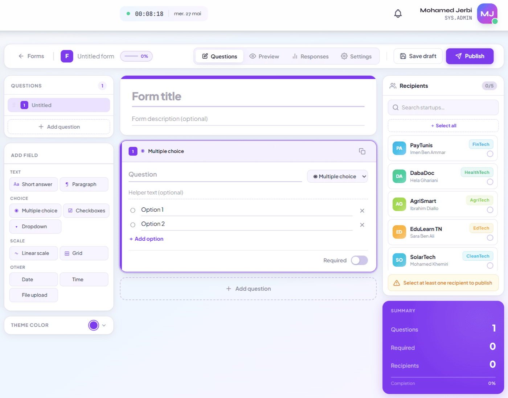<br><sub>Administrateur : création d'un formulaire de candidature configurable</sub></td>
    <td width="50%" valign="top">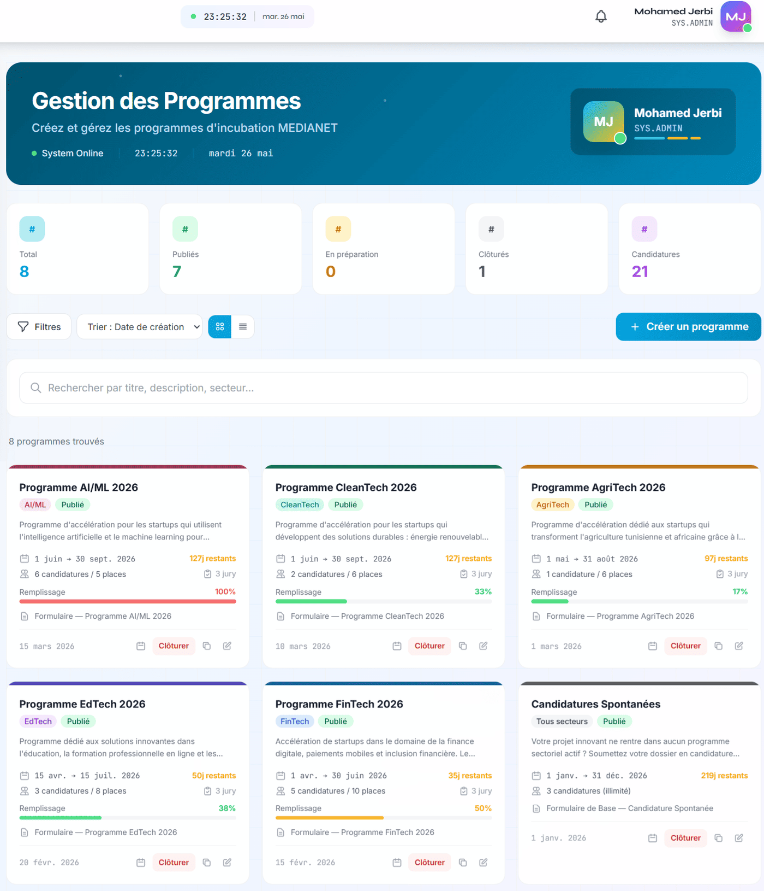<br><sub>Administrateur : gestion des programmes d'incubation</sub></td>
  </tr>
  <tr>
    <td width="50%" valign="top">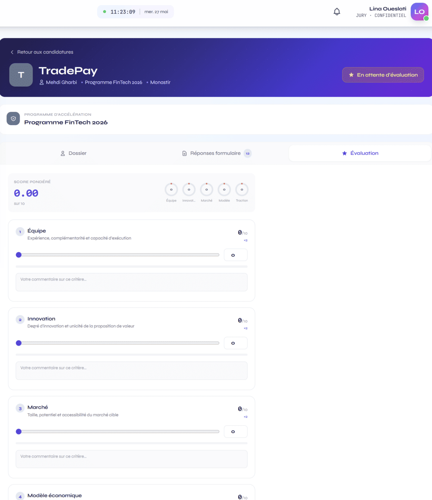<br><sub>Jury : évaluation d'une candidature par critères</sub></td>
    <td width="50%" valign="top">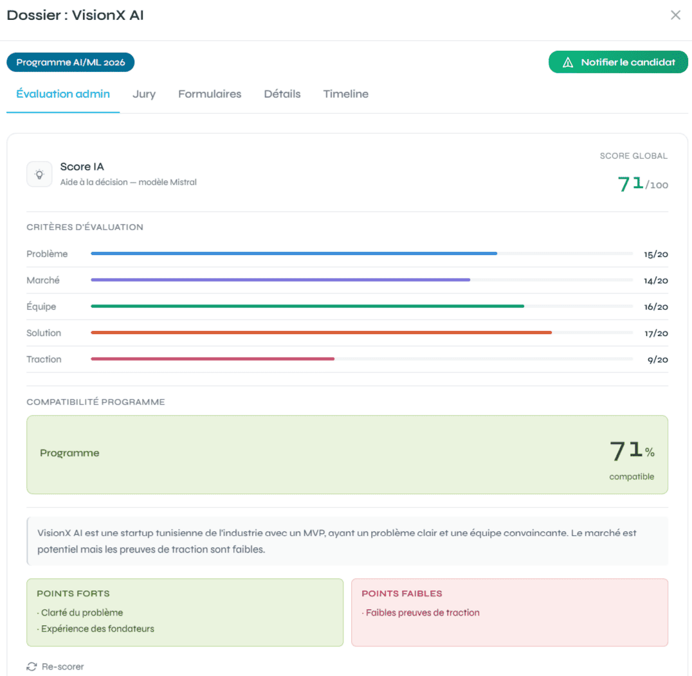<br><sub>Scoring IA : score, compatibilité avec le programme, points forts et faibles</sub></td>
  </tr>
  <tr>
    <td width="50%" valign="top">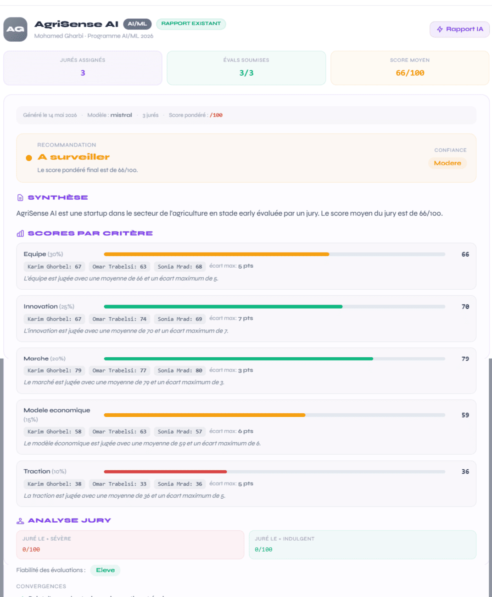<br><sub>Rapport IA : synthèse des évaluations des jurys</sub></td>
    <td width="50%" valign="top">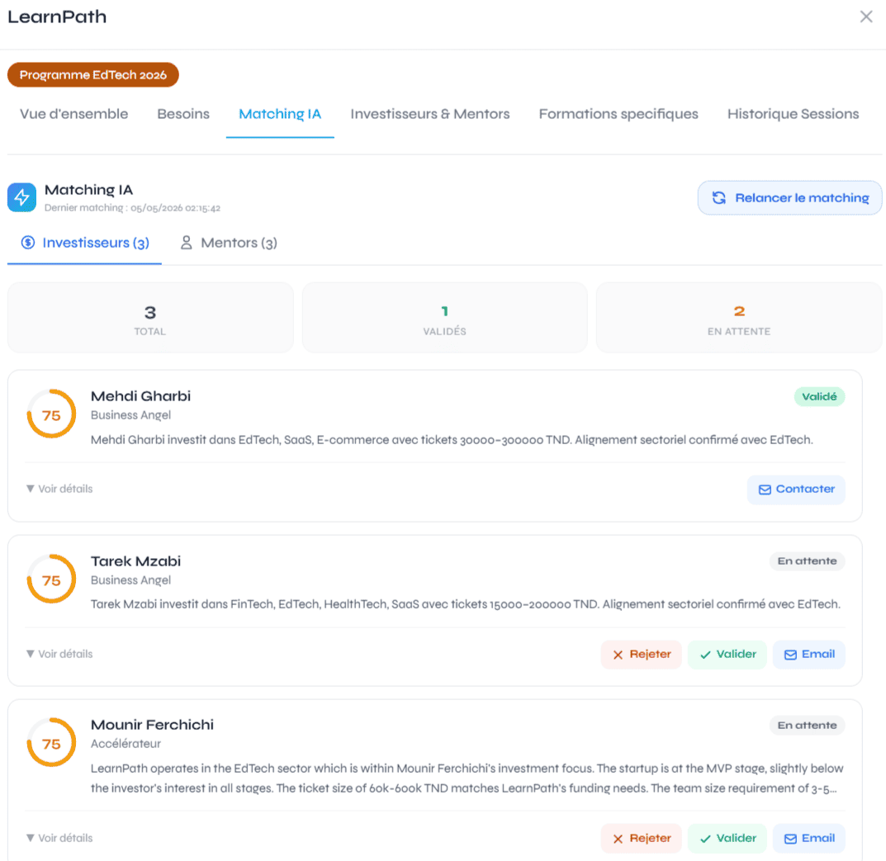<br><sub>Matching IA : investisseurs et mentors recommandés</sub></td>
  </tr>
  <tr>
    <td width="50%" valign="top">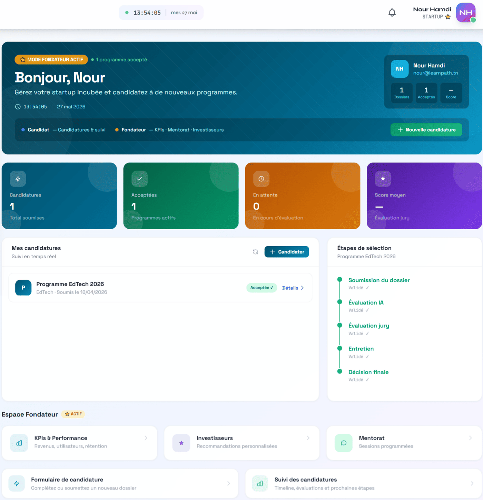<br><sub>Startup incubée : espace fondateur</sub></td>
    <td width="50%" valign="top">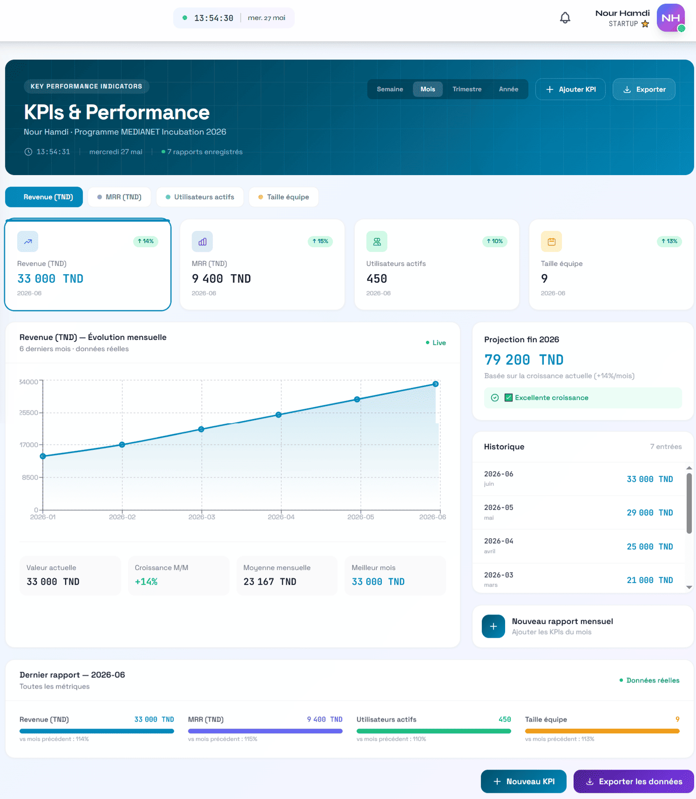<br><sub>Startup incubée : suivi des KPIs et des performances</sub></td>
  </tr>
  <tr>
    <td width="50%" valign="top">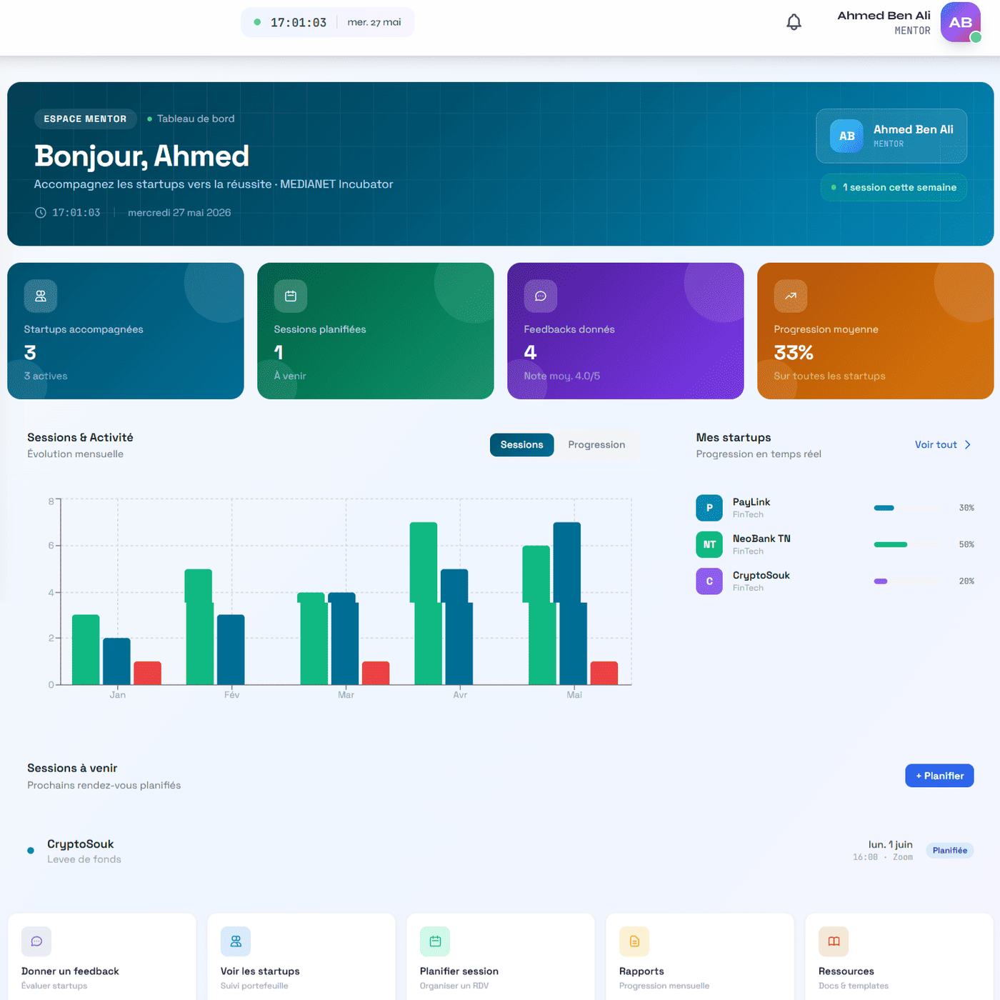<br><sub>Mentor : tableau de bord</sub></td>
    <td width="50%" valign="top">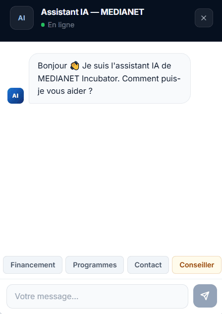<br><sub>Chatbot d'assistance de l'espace public</sub></td>
  </tr>
</table>

## Architecture

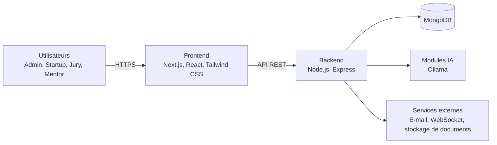

L'architecture est organisée en couches (présentation, métier et API, IA, données, services externes) pour séparer les responsabilités et faciliter l'évolution du projet.

## Stack technique

| Couche | Technologies |
|---|---|
| Frontend | React.js, Next.js, Tailwind CSS |
| Backend | Node.js, Express.js (API REST) |
| Base de données | MongoDB |
| IA | Ollama (LLM local) |
| Authentification | JWT, confirmation de compte par e-mail, contrôle d'accès par rôles |
| Outils | Git, Postman, Figma, Enterprise Architect, draw.io |

## Installation

### Prérequis

- Node.js 18 ou supérieur
- MongoDB (local ou Atlas)
- Ollama avec un modèle installé (pour les modules IA)

### Lancement

```bash
git clone https://github.com/tass027/medianet-incubator.git
cd medianet-incubator
```

Backend :

```bash
cd backend
npm install
cp .env.example .env   # renseigner les variables
npm run dev
```

Frontend :

```bash
cd frontend
npm install
npm run dev
```

<!-- À COMPLÉTER : vérifier les noms des scripts (package.json), les ports et créer le fichier .env.example -->

### Variables d'environnement (backend)

| Variable | Rôle |
|---|---|
| `PORT` | Port de l'API |
| `MONGODB_URI` | Connexion à MongoDB |
| `JWT_SECRET` | Clé de signature des tokens |
| `SMTP_*` | Envoi des e-mails (confirmation, invitations, notifications) |
| `OLLAMA_URL` | Adresse du serveur Ollama |
| `FRONTEND_URL` | URL du frontend (liens des e-mails) |

## Structure du dépôt

```
medianet-incubator/
├── backend/    # API REST, logique métier, modules IA
├── frontend/   # Interfaces Next.js
└── docs/
    └── screenshots/   # Captures d'écran de l'application
```

## Méthodologie

Développement agile avec Scrum, en trois sprints :

| Sprint | Périmètre |
|---|---|
| 1 | Gestion des accès, comptes internes, programmes, formulaires et dépôt de candidatures |
| 2 | Suivi des candidatures, évaluation par les jurys, scoring et rapport intelligents, décision finale |
| 3 | Espace startup incubée, mentors, matching intelligent, sessions, KPIs, documents, chatbot |

Modélisation UML (cas d'utilisation, classes, séquence, activité) et maquettes Figma réalisées avant l'implémentation.

## Auteure

Tasnim Elmehrabi — [GitHub](https://github.com/tass027) · [LinkedIn](https://www.linkedin.com/in/VOTRE-PROFIL)
